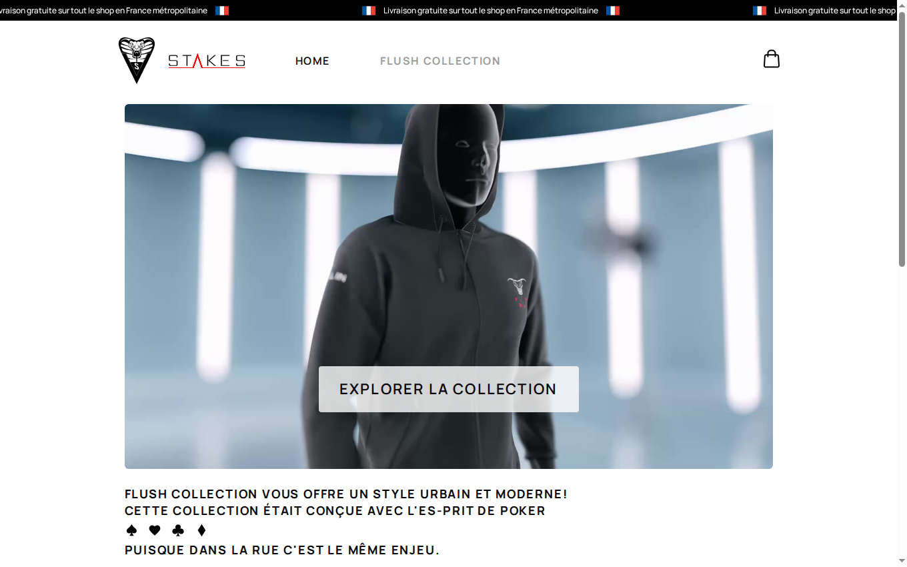
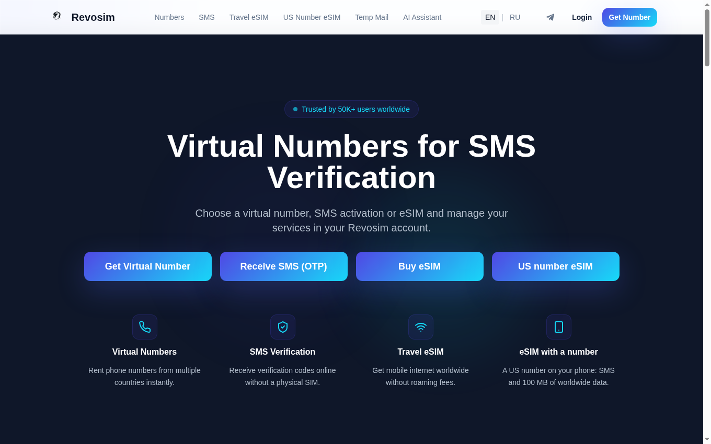

# qzbxw

**Full-Stack & Automation Engineer** (Go · Python · TypeScript / Next.js · Svelte / Shopify · AI/LLM · Docker/VPS)

## Commercial Experience (Client-Owned)

| STAKES | Revosim |
| --- | --- |
|  |  |
| Built a headless Svelte storefront backed by Shopify for product browsing and checkout. | Built a Next.js platform for eSIM, SMS verification, and Voice AI workflows with Telnyx and Telegram bots. |

## Open Source Highlights

| Project | What it does |
| --- | --- |
| [EGO](https://github.com/qzbxw/EGO) | Self-hosted AI agents with Go orchestration, Python reasoning, a Docker sandbox, pgvector retrieval, and a Svelte UI. |
| [recv](https://github.com/qzbxw/recv) | Non-custodial USDT, TON, and TRON payment gateway with a processing API and checkout. |
| [velox](https://github.com/qzbxw/velox) | Python Telegram bot for real-time Hyperliquid alerts and Gemini market briefs. |
| [keeper](https://github.com/qzbxw/keeper) | Go and PostgreSQL micro-CRM for Telegram Business ad bookings, reminders, and spend reports. |
| [Floorline](https://github.com/qzbxw/floorline) | Go trading desk for Telegram Gifts with live pricing, liquidity checks, portfolio tracking, and optional automated execution. |

## Available for Fast-Turnaround Orders

- Telegram bots and workflow automation
- Web scrapers and API reverse engineering
- Next.js, Svelte, and Shopify fixes
- AI/LLM integrations and Docker/VPS setups

**EN / RU** · [Telegram @qzbxw](https://t.me/qzbxw)
